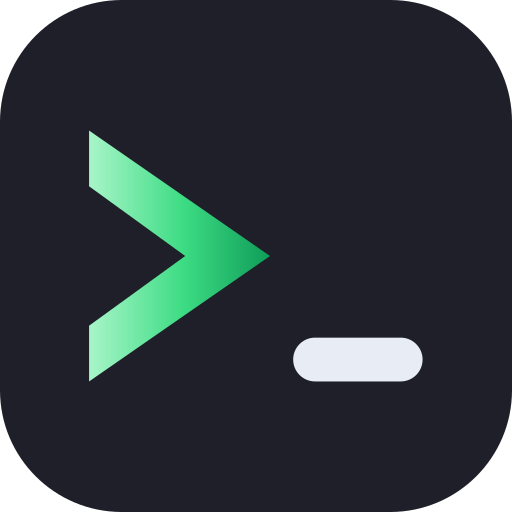
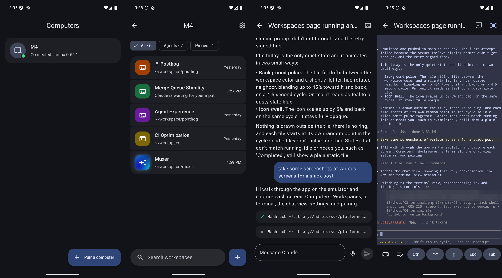

<p align="center">
  
</p>

# Muxer

Watch and drive your [cmux](https://github.com/manaflow-ai/cmux) terminals from an Android phone. See every workspace, open a live terminal, type into it, and get notified when a coding agent needs you.

It works with any cmux plan, and you don't need to sign in to cmux. Everything runs between your phone and your own computer, over a private network you control, with no cloud service in the middle. [Tailscale](https://tailscale.com) is the easiest way to set that up. Another VPN, a trusted local network, or a Cloudflare Tunnel behind Cloudflare Access also work.

<p align="center">
  
</p>

> This is an independent project. It is not made, endorsed, or supported by Manaflow or the cmux team.

## How it works

```
Android app ──HTTPS + WebSocket over your private network──▶ muxer (on your computer) ──Unix socket──▶ cmux
```

`muxer` is a small program that runs on your computer. It talks to cmux through cmux's local control socket and gives the phone:

- the list of windows, workspaces and terminals, with agent status and unread counts,
- a live view of one terminal, sent as changed rows only, and the keys you type,
- cmux notifications (for example "Claude is waiting for your input"), with their text.

The relay itself listens on `127.0.0.1`. The phone reaches it through an HTTPS proxy in front of it that only your devices can reach, such as `tailscale serve`. See [Reaching the relay](#reaching-the-relay) for the options.

## Set up your computer

You need cmux 0.65 or later on the computer, and a way for the phone to reach the computer over HTTPS. The steps below use Tailscale, signed in on the computer and on the phone. For other setups, see [Reaching the relay](#reaching-the-relay).

1. **Install the relay** with [Homebrew](https://brew.sh):

   ```sh
   brew install gantoine/tap/muxer
   ```

   <details>
   <summary>Other ways to install it</summary>

   - **Download:** get `muxer-<version>-darwin-arm64.tar.gz` (Apple silicon) or `-darwin-amd64.tar.gz` (Intel) from the [releases page](../../releases), check it against `SHA256SUMS`, extract it, and move `muxer` into a folder on your `PATH`. The binary is not notarized by Apple. If you downloaded it with a browser, run `xattr -d com.apple.quarantine muxer` before the first run.
   - **From source** (Go 1.26 or later): `go install github.com/gantoine/muxer/relay/cmd/muxer@latest`

   </details>

2. **Let the relay talk to cmux.** By default cmux only accepts programs started inside cmux terminals. The relay runs in the background, so switch the socket mode to **password** (recommended) or **automation**:
   - In cmux, open **Settings › Automation** and set socket access to **Password**, then set a password. The relay reads it from `~/.local/state/cmux/socket-control-password`, the same file the cmux CLI uses.
   - Or set `"automation": { "socketControlMode": "automation" }` in `~/.config/cmux/cmux.json`. This lets any program running as your user control cmux without a password.

3. **Start the relay at login.**

   ```sh
   muxer install
   ```

4. **Make it reachable from your phone only.** With Tailscale:

   ```sh
   tailscale serve --bg --https=8765 http://127.0.0.1:8765
   ```

5. **Check everything.**

   ```sh
   muxer doctor
   ```

## Pair your phone

Install the APK from the [releases page](../../releases). To check it first, run `apksigner verify --print-certs muxer-<version>.apk` and compare the SHA-256 certificate fingerprint with this one:

```
9D:6C:85:65:17:81:34:51:CF:1D:82:8F:BC:A0:AE:91:B0:D4:C5:92:B0:74:04:0F:72:19:19:DB:C5:61:5C:8B
```

Then run this on your computer:

```sh
muxer pair
```

`muxer pair` uses the computer's Tailscale name. If the phone reaches the relay another way, pass that address: `muxer pair --url https://muxer.example.com`.

Scan the QR code with your phone's camera, or tap **Pair a computer** in the app and type the address and code. The code works once and expires after 10 minutes.

Pair as many computers as you like. Each one shows up in the app's **Computers** list.

## Reaching the relay

The phone talks to the relay over HTTPS, and the app only accepts certificates from a public certificate authority. It refuses plain HTTP and self-signed certificates. Keep the relay on `127.0.0.1` and put something in front of it that adds HTTPS and lets only your own devices through:

- **Tailscale:** `tailscale serve` does both. It adds a certificate for the computer's tailnet name and keeps the relay inside your tailnet. `muxer pair` and `muxer doctor` set it up for you.
- **Another VPN** (WireGuard, ZeroTier and so on) **or your local network:** run a reverse proxy such as [Caddy](https://caddyserver.com) on the computer. Point a domain you own at the computer's private address and get a Let's Encrypt certificate with a DNS challenge. Only do this on a network where you trust every device.
- **Cloudflare Tunnel:** put the relay behind Cloudflare Access so only your devices get through. The app cannot complete a browser sign-in, so Access has to recognize the phone another way, for example through the Cloudflare One (WARP) client enrolled in your Zero Trust organization.

Then pair with that address using `muxer pair --url`.

## Using the app

- **Workspaces:** each workspace shows its color, a robot icon when an agent runs in it, and when it was last active. Type in the search box to filter by name, folder, or terminal. Tap a workspace to open its terminal. Long-press to rename it, add a terminal, or close it. Tap **+** to create a workspace. Workspace groups from cmux show as their own card. Tap the group's name to fold its workspaces away, and tap the row under it to open the group's own terminals.
- **Terminal:** pinch to zoom and drag sideways to pan.
- **Scrolling back:** swipe down to read earlier output. The phone loads up to 2,000 lines of history and scrolls it locally, so the view on your computer does not move. Tap **Live** or scroll to the bottom to follow the terminal again. In full-screen programs such as vim or Claude Code, swiping scrolls inside the program on the computer instead.
- **Copying:** long-press a word to select it, drag to extend the selection, then tap **Copy**. Selections can span history and the live screen.
- **Typing:** tap the terminal and type. Every key goes straight to the computer, with autocorrect and suggestions turned off. A hardware keyboard works too, including Ctrl and Alt shortcuts. The key bar has sticky Ctrl, ⌥ (Option/Alt) and ⇧ (Shift) keys that apply to the next key, plus Esc, Tab, arrows, ^C, ^D, backspace, Enter, and paste.
- **Messages:** tap the note icon in the key bar to open a message box with autocorrect and voice dictation. **Send** pastes the message and presses Enter, which suits writing to a coding agent. While an agent's permission or plan prompt is open, the box reads **Send message after you answer**: the message goes through cmux's agent messaging instead of being typed into the prompt, and the agent gets it once you've answered.
- **Claude Code as a chat:** open a terminal that runs Claude Code and the app shows the conversation as a chat instead of the terminal: your messages, Claude's replies, and each tool it runs (tap one to see its output). Type or dictate in the box at the bottom, and tap stop to interrupt Claude. The app switches to the chat when Claude starts in that terminal and back to the terminal when it exits, whether you started or quit it on the phone or on the computer. The chat icon at the top switches by hand.
- **Answering agents:** when an agent asks for permission, asks a question, or has a plan ready, a card appears at the bottom of its chat or terminal with a countdown, and a notification with action buttons reaches you if you're elsewhere. Allow a tool once or always, or deny it. Pick an answer, or choose **Type something** to answer in your own words. Approve, auto-accept, revise or reject a plan. An answer given on the computer clears the card on the phone. If an agent's prompt can't be answered from a card, tap **Answer** to switch to the terminal.
- **Message receipts:** messages sent through agent messaging show above the message box until the agent has read them: waiting, delivered, or why it failed.
- **Retries:** when an agent stops on a temporary error, such as an overloaded model, and cmux schedules a retry, a banner counts down to it, and the phone holds back that agent's notification until it has been retried.
- **Fit to phone:** while you view a terminal, cmux resizes it to the phone's screen, so lines wrap instead of running off the side. cmux gives the size back when you leave the terminal. Turn it off with the fit icon to see the terminal at its size on your computer; the app remembers your choice.
- **Background notifications:** open a computer, tap the gear icon, and turn on **Stay connected in the background**. The app then keeps a connection to that computer open in a foreground service, so its cmux notifications reach you while the app is closed. Each computer has its own switch, and a bell on the **Computers** list marks the ones that are on. Reading a notification on the computer removes it from the phone.
- **Keep awake:** the same page has **Keep this computer awake**, which turns on cmux's Keep Mac Awake so idle sleep doesn't cut your phone off while agents run. It stops idle sleep only: closing a laptop's lid still puts it to sleep, and quitting cmux turns it off. A coffee cup on the **Computers** list marks computers kept awake, including when you turned it on at the computer.
- **Computer settings:** the same page lets you rename the computer, see its address and versions, and remove it.
- **Quick Settings tile:** add the **Muxer** tile from your phone's Quick Settings editor. Tap it to turn **Stay connected in the background** on for every computer, or off for all of them when they're all on. The tile shows how many of those computers are connected right now. If notifications aren't allowed yet, tapping it opens the app instead.
- **Agents in the background notification:** while **Stay connected in the background** is on, the notification that keeps the connection open shows what your agents are doing instead of a fixed line: how many are working, waiting for you, or about to retry, one line per agent, and a timer for the longest-running one or a countdown to the next retry. On Android 16 it also shows as a chip in the status bar. Tap it to open the one active terminal, or the app when there are several. Swipe it away if you'd rather not see it; the connection stays open. Leave a computer's agents out of it with **Show what agents are doing** on its settings page.
- **Widgets:** long-press your home screen and add a Muxer widget. **Waiting for you** lists every agent prompt across your computers, newest first, plus agents that have finished a turn and wait for your next message. Allow, deny or approve right from the widget, pick an answer, or tap a row to open the terminal. It also counts down agents that are about to retry. **Workspaces** shows each workspace as waiting, needing you, retrying, working or idle, with its color, unread count and last activity, grouped by computer when you have more than one. Shrink it to a single row to see just the counts. Widgets show what the app last saw, so they stay current while the app is open or background notifications are on. A header reading "as of 14:05" means the data is older than that. Tap the refresh icon to connect for a moment and update. While a widget is on your home screen, Muxer also checks in about every 15 minutes.
- **Conversations, bubbles and replies:** Muxer adds a launcher shortcut for each workspace where an agent runs, so your phone treats it as a conversation. Long-press the app icon to jump into one, or pick **Pair a computer** from the same menu. Long-press a workspace and tap **Add to Home screen** to pin it. Notifications for the same terminal stack into one conversation that shows the last few messages. Tap **Message** to write to the agent without opening the app; what you sent shows up in the conversation. Questions get a **Type an answer** button. On Android 11 or later, tap the bubble icon on a notification to open that terminal in a floating bubble. Notifications come in three channels you can tune in Android's settings: **Agent requests**, **Agent finished**, and **Terminal alerts** for everything else cmux posts, including automation alerts.

## Custom alerts with cmux automations

The phone shows every notification cmux posts, so a [cmux automation](https://github.com/manaflow-ai/cmux/blob/main/docs/automations.md) with a `notify` action also reaches your phone. Muxer needs no setup for this. For example, this rule in `~/.cmuxterm/automations.json` tells you when cmux types "continue" for an agent after an overload:

```json
{
  "version": 1,
  "rules": [
    {
      "id": "phone-auto-resume",
      "when": { "event": "agent.auto_resume.sent" },
      "then": [
        {
          "action": "notify",
          "title": "Agent resumed",
          "body": "{{payload.agent}} was resumed after a temporary error (attempt {{payload.attempt}})."
        }
      ]
    }
  ]
}
```

Run `cmux automation reload` after editing the file, and `cmux automation test phone-auto-resume --event '{"name":"agent.auto_resume.sent","category":"agent","payload":{"agent":"claude","attempt":1}}'` to check a rule without firing it. The **Alert me when an agent finishes** setting and the filter that drops "waiting for your input" alerts apply to these notifications too.

## Updating the relay

```sh
brew upgrade muxer
muxer install
```

Running `muxer install` again restarts the background relay on the new version. Paired phones stay paired.

If you installed the relay when it was called `cmux-relay`, `brew upgrade` moves you to `muxer`. Run `muxer install` once afterwards: it stops the old background relay, removes it from login items, and keeps your paired phones.

## Managing phones

```sh
muxer devices          # list paired phones
muxer revoke DEVICE_ID # disconnect a phone and make it pair again
muxer uninstall        # stop the relay and remove it from login items
```

The relay logs to `~/Library/Logs/muxer.log`.

## Security

- The phone can do what you can do in cmux: read every terminal and type into it. Pair only phones you control, and revoke lost ones.
- Each phone gets its own random token. The computer stores only a SHA-256 hash of it, in `~/Library/Application Support/muxer/devices.json` (mode 0600). The phone keeps it encrypted with a key in the Android Keystore.
- Pairing codes are single-use, expire after 10 minutes, and stop working after 10 wrong guesses.
- The relay listens on `127.0.0.1` only. Put it behind an HTTPS proxy that only your devices can reach, such as `tailscale serve`. Never expose it with `tailscale funnel`, an open port, or a tunnel without access control.
- Pairing, listing, and revoking use a Unix socket that only your user can open, never the network.
- The relay only forwards the commands listed in the protocol below. It is not a general cmux socket proxy.

## Limits

- The relay uses cmux's `mobile.*` socket methods, which power the official iOS app. cmux does not document them, so a cmux update can break the relay. `muxer doctor` and the relay log show what failed.
- cmux has no way to push terminal output over its local socket, so the relay polls the terminal you are viewing: about 12 times a second while it changes, slowing to once a second when idle. It polls only while a phone has a terminal open.
- History you scroll back through is loaded once. While you read it, the live screen keeps updating, but lines that scroll off the screen meanwhile are not added. Tap **Live** and scroll up again to reload it.
- The chat view reads Claude Code's transcript files in `~/.claude/projects` (or `CLAUDE_CONFIG_DIR`). It finds the session for a terminal through cmux, or else through the running sessions Claude Code lists in `~/.claude/sessions`, matched to the terminal by the `CMUX_SURFACE_ID` that cmux sets in its shells. Claude Code does not document these files, so a Claude Code update can break the chat view; the terminal view keeps working.
- Background notifications need the foreground service. Without it, notifications that arrive while the app is closed are delivered the next time you open it.

## Development

```sh
# relay
cd relay && go test -race ./... && go build ./cmd/muxer

# Android app (JDK 21 and the Android SDK)
./gradlew :app:testDebugUnitTest :app:assembleDebug
```

To run the relay next to an installed copy, give it its own state directory and port:

```sh
cd relay && MUXER_STATE_DIR=/tmp/relay-dev go run ./cmd/muxer serve --listen 127.0.0.1:18765
```

On the Android emulator the computer is `http://10.0.2.2:18765`. Debug builds allow plain HTTP to that address only.

### Releasing

Publish a GitHub release whose tag is a semantic version such as `0.2.0` or `0.2.0-beta.1`, with no `v` prefix. The release workflow tests everything, then attaches the relay for Apple silicon and Intel Macs, the signed APK, and `SHA256SUMS` to that release. The app's version name is the tag, and its version code is `major × 1,000,000 + minor × 1,000 + patch`.

Signing uses the `SIGNING_KEYSTORE_BASE64`, `SIGNING_KEYSTORE_PASSWORD` and `SIGNING_KEY_PASSWORD` secrets and the `SIGNING_KEY_ALIAS` variable.

For releases that are not marked as pre-releases, the workflow also updates the `muxer` formula in [gantoine/homebrew-tap](https://github.com/gantoine/homebrew-tap). It renders the formula with `packaging/homebrew/render-formula.sh` and pushes as a GitHub App that is installed only on the tap with contents write access. The workflow reads the app's ID from the `HOMEBREW_TAP_APP_ID` variable and its private key from the `HOMEBREW_TAP_APP_PRIVATE_KEY` secret, and each token it creates lasts one hour.

After the files are attached, a second job uploads the APK and both relay tarballs to [VirusTotal](https://www.virustotal.com) with `packaging/virustotal/scan.sh`. It waits for the scans to finish and adds a table of detection counts and report links to the end of the release notes. Rerunning the job replaces that table instead of adding a second one. The job reads its API key from the `VT_API_KEY` secret, and a free key is enough because the script waits between requests to stay under the public API rate limit.

### Relay protocol

The phone opens `GET /v1/ws` with `Authorization: Bearer <token>` and exchanges JSON messages.

| From phone | Purpose |
| --- | --- |
| `hello {notifications_after}` | Start the session. The answer carries the computer name and cmux version. |
| `attach {workspace_id, surface_id, fit?}` / `detach` / `resync` | Choose the terminal to stream. |
| `input {text}` / `key {key}` / `paste {text, submit}` / `scroll {lines}` | Send input to the attached terminal. |
| `history {lines?}` | Get up to 5,000 lines above the attached terminal's screen, oldest first, with their own style table. The default is 2,000. |
| `fit {columns, rows}` / `unfit` | Ask cmux to size the terminal for the phone. |
| `create_workspace`, `rename_workspace`, `close_workspace`, `create_terminal` | Manage workspaces. |

The relay sends `workspaces` (with the workspace `groups`, each naming its anchor workspace and members), `screen` (row diffs with a style table), `detached`, `notification` and `result {id, ok, data | error}`. For the attached terminal it also sends `chat_session {surface_id, session_id}`, with `session_id` null when no Claude Code session runs there, and `chat {surface_id, session_id, reset, entries}`, where each entry is a user message, an assistant reply, a tool call or a notice. `reset` replaces the conversation; otherwise entries with a known `id` replace the old ones and new ones are added at the end. Add an `id` to any message to get a `result` back.

## License

MIT. See [LICENSE](LICENSE).

The logo remixes the chevron from the cmux icon. cmux and its logo belong to Manaflow, Inc. Using them here does not mean Manaflow made, endorses, or supports this project. If you are from Manaflow and want the logo changed, open an issue.
